<div align="center">


# Horizon Auto Export

**Website, vehicle catalogue and admin dashboard for a Bucharest car dealer:
new and used vehicles, delivered across Europe.**

[](https://horizonautoexport.com/en)
[](LICENSE)


</div>

<br />

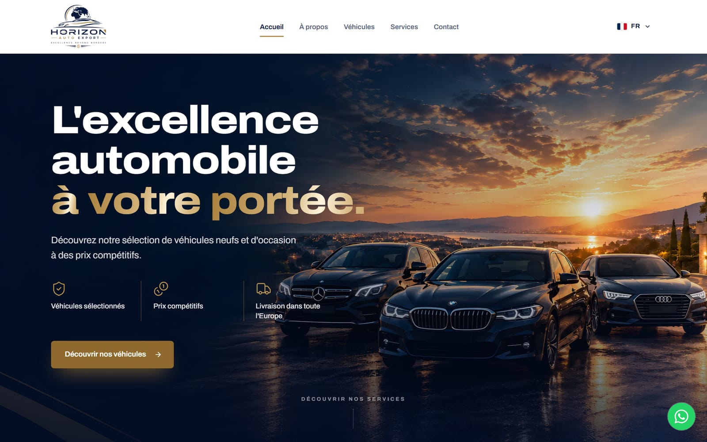

## Overview

Horizon Auto Export is a car dealership based in Bucharest, Romania. This repository contains
its production website and the private dashboard its team uses to run it:

- **Public website** in Romanian, English and French. It presents the company and its stock,
  and turns visitors into customer requests.
- **Admin dashboard** for publishing vehicles, handling requests and editing the site's
  details. It needs no developer involvement.
- **Backend on Supabase** (Postgres, Auth, Storage and edge functions). It is secured with
  row-level security and tested against a real Postgres engine.

## Highlights

### Website
- **Three languages** (RO · EN · FR), each with its own URLs and hreflang tags. The visitor's
  language is detected automatically.
- **Vehicle catalogue** with filters for category, make, fuel, gearbox and model year. The
  filters are kept in the URL, so a filtered list can be shared.
- **Vehicle pages** with:
  - a photo gallery;
  - the full specifications, including first registration date and accident-free history;
  - the ticked options;
  - the price including VAT, and the net price when VAT is deductible.
- **Contact flow** through a form, WhatsApp or a phone call. Every request is saved first and
  then e-mailed to the business.
- **Motion design** with GSAP and Lenis, including a cinematic hero intro on desktop. It is
  fully disabled for visitors who choose reduced motion.

### Admin dashboard
- A **dashboard** with stock and request KPIs and a 30-day chart.
- **Requests** sorted by follow-up stage, with reply by e-mail, phone or WhatsApp, internal
  notes and Excel export.
- **Vehicles**:
  - text in three languages and the full specifications;
  - an options checklist (51 options);
  - photos that are compressed before upload and can be reordered;
  - private fields (VIN, purchase price, margin) that never reach the public site.
- **Makes**, **site settings** (contact details, hero photo) and **team accounts**, with
  access set per section.
- The dashboard itself is available in Romanian, English and French.

### Engineering
- **Server-side trust only.** Every form is re-validated in Postgres. The form is protected
  by:
  - bot timing checks;
  - a limit on requests per sender;
  - a flood guard that files excess requests as spam without sending e-mails.
- **Database access rules.** Every table is protected by row-level security, and staff
  permissions are enforced by the database itself, not only by the interface.
- **Hardened delivery.** A strict Content Security Policy, HSTS and other security headers,
  no secrets in the client, and a clean dependency audit.
- **Social link previews.** An edge function shows each vehicle's photo, title and price
  when its link is shared on WhatsApp or Facebook.
- **Performance.**
  - Phones get a hero image cropped for their screen, which is preloaded.
  - Images are compressed when uploaded.
  - Scripts are split, and below-the-fold animations wait until the browser is idle.

## Screenshots

<table>
  <tr>
    <td width="50%">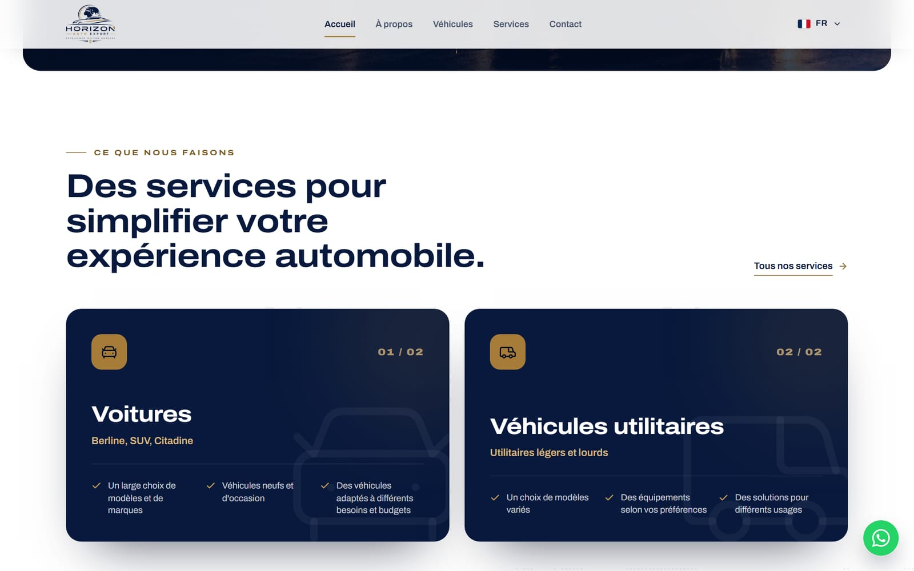</td>
    <td width="50%">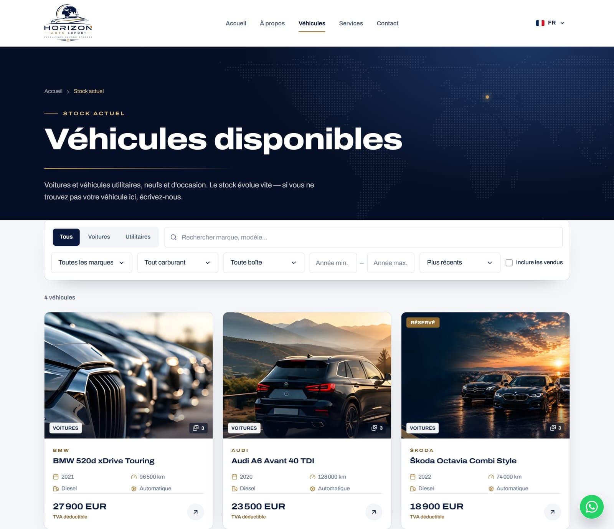</td>
  </tr>
  <tr>
    <td align="center"><sub>Services</sub></td>
    <td align="center"><sub>Vehicle catalogue with filters</sub></td>
  </tr>
  <tr>
    <td width="50%">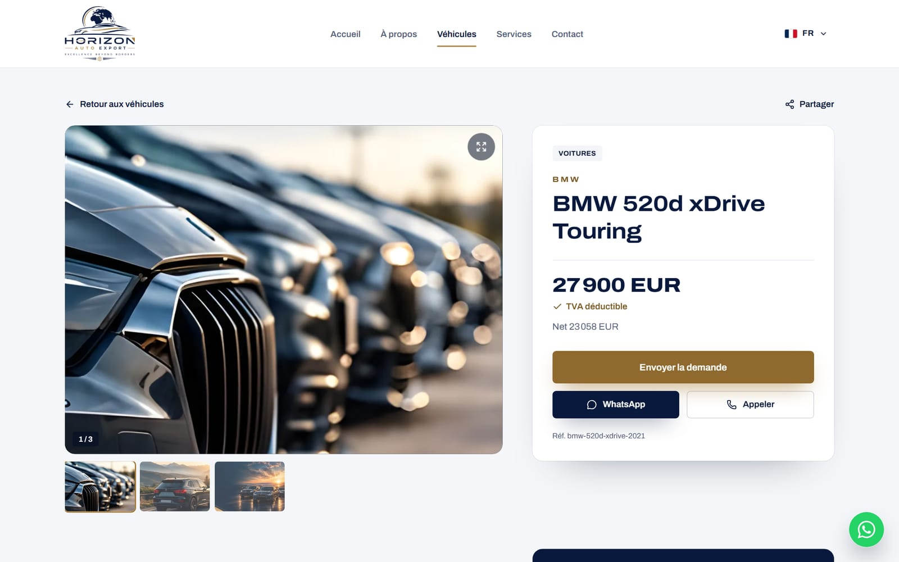</td>
    <td width="50%">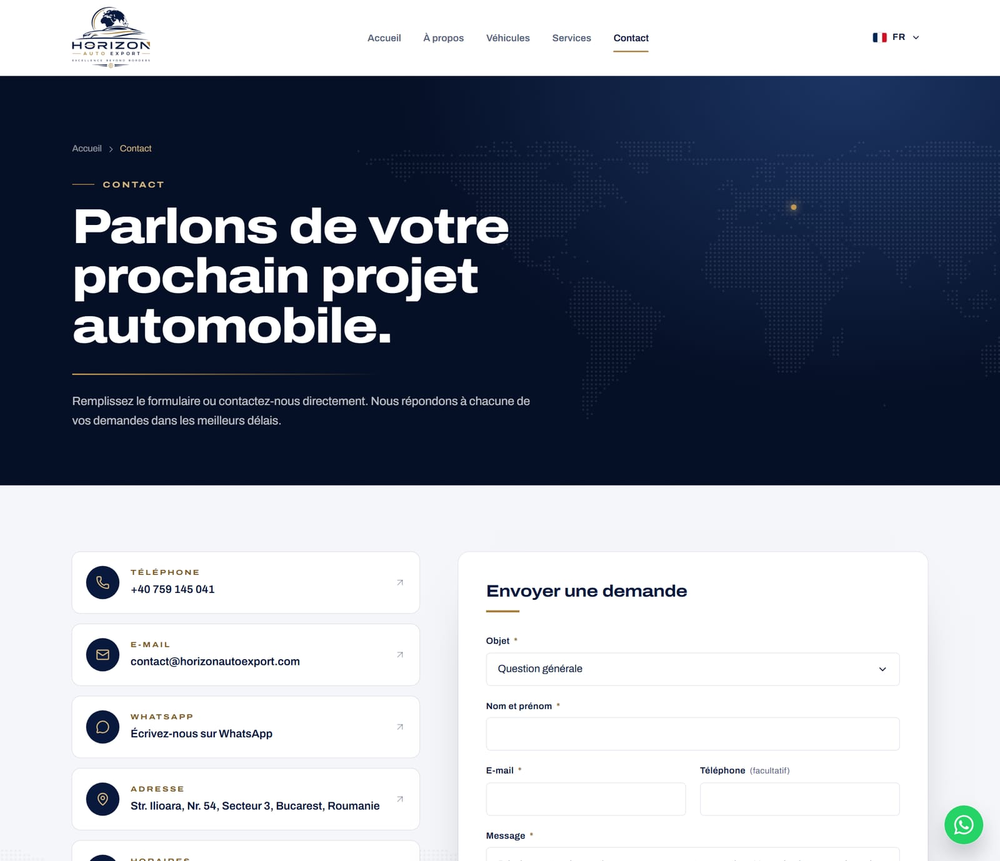</td>
  </tr>
  <tr>
    <td align="center"><sub>Vehicle page</sub></td>
    <td align="center"><sub>Contact</sub></td>
  </tr>
  <tr>
    <td colspan="2">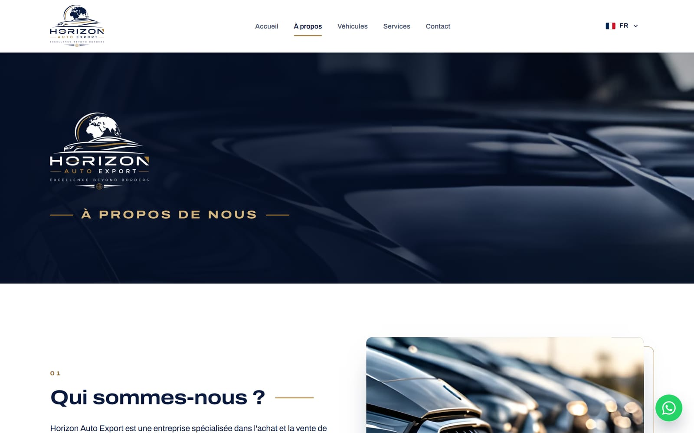</td>
  </tr>
  <tr>
    <td colspan="2" align="center"><sub>About</sub></td>
  </tr>
</table>

### On mobile

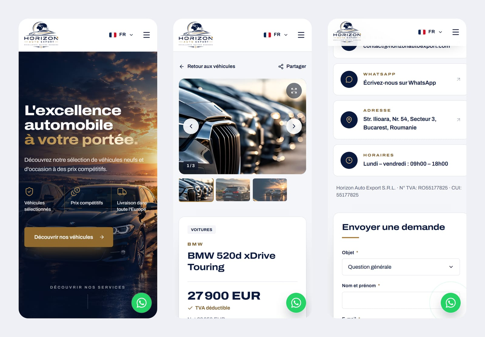

### Admin dashboard

<table>
  <tr>
    <td width="50%">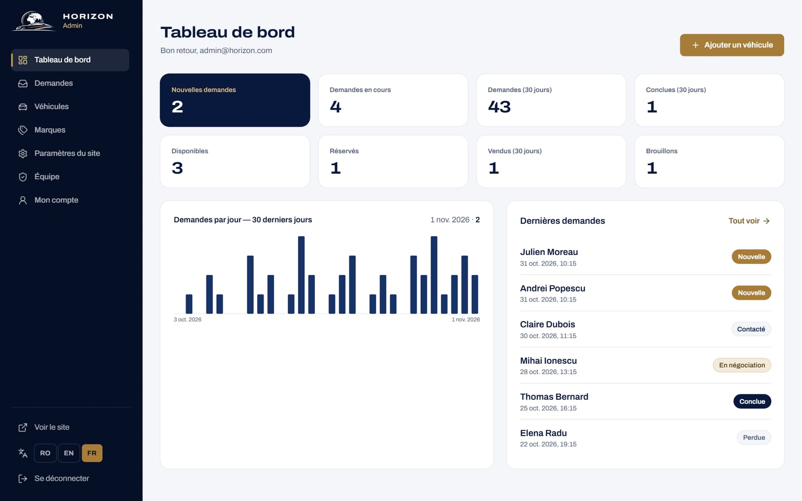</td>
    <td width="50%">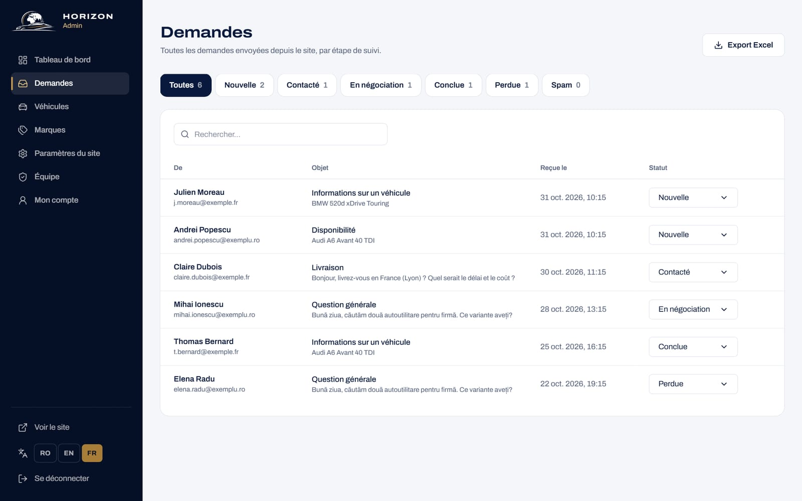</td>
  </tr>
  <tr>
    <td align="center"><sub>Dashboard</sub></td>
    <td align="center"><sub>Customer requests</sub></td>
  </tr>
  <tr>
    <td width="50%">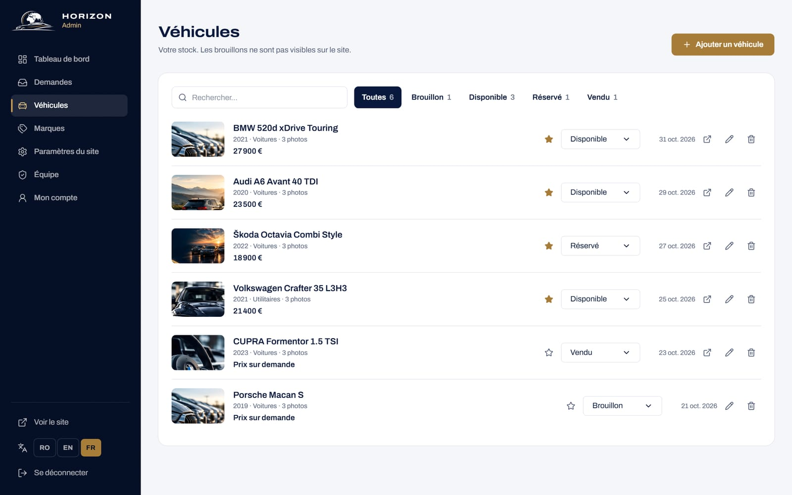</td>
    <td width="50%">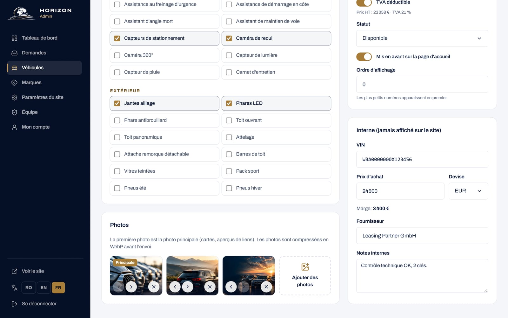</td>
  </tr>
  <tr>
    <td align="center"><sub>Vehicle stock</sub></td>
    <td align="center"><sub>Vehicle editor: options, photos, private data</sub></td>
  </tr>
</table>

<sub>The catalogue and dashboard screenshots use sample vehicles and requests.</sub>

## Tech stack

| Layer    | Technologies                                                                                            |
| -------- | ------------------------------------------------------------------------------------------------------- |
| Frontend | React 18 · TypeScript (strict) · Vite · Tailwind CSS v4 · React Router · TanStack Query                 |
| Motion   | GSAP (ScrollTrigger, SplitText) · Lenis · Motion                                                        |
| Forms    | react-hook-form · Zod. Every input is re-validated server-side                                          |
| Backend  | Supabase: Postgres with row-level security, RPC functions, Auth, Storage, Deno edge functions           |
| E-mail   | Resend, through a Supabase edge function                                                                |
| Hosting  | Vercel: static SPA, Edge Middleware for link previews, strict security headers                          |
| Quality  | Bun · Biome · Vitest · PGlite (Postgres-in-WASM database tests) · Playwright · Lighthouse               |

## Quality

| Check                        | Result                                                                              |
| ---------------------------- | ----------------------------------------------------------------------------------- |
| Unit tests (Vitest)          | 46 passing                                                                          |
| Database tests (PGlite)      | 83 checks across 13 migrations: access rules, form validation, rate limits          |
| End-to-end tests (Playwright)| 28 passing, desktop and mobile, including the admin dashboard and the Excel export  |
| Lighthouse (live, desktop)   | Performance 93 · Best practices 100 · SEO 100                                       |
| Lighthouse (live, mobile)    | Accessibility 100 · Best practices 100 · SEO 100                                    |
| Static analysis              | TypeScript strict and Biome, both clean · `bun audit`: no known vulnerabilities     |

## Project structure

```text
src/
  pages/          Public pages, plus pages/admin for the dashboard
  components/     Layout, page sections, vehicle UI, forms, motion effects
  i18n/           Romanian, English and French dictionaries
  lib/ hooks/     Data access, formatting, VAT, SEO, contact helpers
supabase/
  migrations/     Database schema, access rules and functions, applied in order
  functions/      Edge functions: e-mail notifications, staff accounts
middleware.ts     Vercel edge middleware for social link previews
tests/            Unit and end-to-end tests
scripts/          Database test runner, SEO files, image pipeline
```

Maintenance and deployment notes for the team are in [`docs/DEVELOPMENT.md`](docs/DEVELOPMENT.md).

## Developer

Designed and developed by **[Alaa Younsi](https://alaayounsi.vercel.app)**.

## Licence

**Copyright © 2026 Alaa Younsi. All rights reserved.**

This code is published for viewing only. No permission is granted to use, copy, modify or
distribute it, in whole or in part. See [LICENSE](LICENSE). The Horizon Auto Export name,
logo, photographs and content belong to Horizon Auto Export S.R.L.
